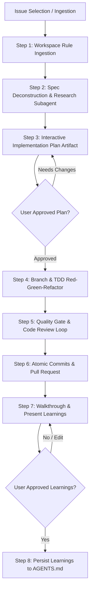

# Implement Story Skill (Interactive Edition)

This skill guides the agent in an interactive, collaborative feature implementation workflow driven by formal AI specifications (Spec-Driven Development / SDD). In this interactive mode, the agent pairs closely with the user, seeking approval at critical checkpoints before modifying code or persisting rules.

---

## Execution Workflow



### 1. Workspace Rule Ingestion & Issue Selection
- **Pre-flight Rule Check:** Before doing anything, inspect the workspace root `AGENTS.md` and any submodule `AGENTS.md` (e.g. `backend/.agents/AGENTS.md`, `frontend/.agents/AGENTS.md`, `database/.agents/AGENTS.md`). Strictly internalize and obey project rules (e.g., test/lint commands, branch conventions, and prohibitions such as never applying database migrations manually or committing secrets).
- Verify the GitHub CLI (`gh`) is installed and authenticated.
- **Issue Ingestion:**
  - If the user specified an issue number (e.g. `/implement-github-story-interactive #42`), fetch that issue directly.
  - Otherwise, fetch open issues: `gh issue list --limit 10`.
  - Present the list to the user and ask them to select the issue to implement.
  - **Fallback:** If no open issues exist, invoke the `write-github-story` skill to gather requirements and create one first.

### 2. Spec Deconstruction & Research Subagent Delegation
- Read the full issue description: `gh issue view <issue-id>`.
- **Deconstruct the AI Specification:**
  - Extract the in-scope **Goals** and explicitly respect the **Non-Goals (Out of Scope)** to prevent scope creep.
  - Extract the **Acceptance Criteria** and construct a **Traceability Matrix** (mapping each criterion directly to an anticipated test scenario).
  - Extract API contracts, database schema requirements, and non-functional requirements (NFRs).
- **Delegate Research to a Subagent:**
  - Launch a `research` subagent to thoroughly explore the codebase without cluttering the parent context.
  - The subagent must identify:
    - Target files to create or modify across frontend, backend, and database modules.
    - Existing architectural patterns, shared services, and UI components to reuse.
    - Test harness patterns, mock factories, fixtures, and existing test utilities.
    - Submodule-specific guidelines or constraints from local `.agents/AGENTS.md` files.

### 3. Interactive Implementation Plan Artifact
Using the research subagent's findings, generate a detailed **Implementation Plan** artifact (`write_to_file` in the artifact directory with `ArtifactMetadata` and `RequestFeedback: true`).

The plan **MUST** contain:
1. **Summary & Scope:** Brief overview referencing the issue, goals, and explicit non-goals.
2. **Spec Traceability Matrix:**
   | Acceptance Criterion | Implementation Task | Test File & Scenario |
   | --- | --- | --- |
   | [Given X, When Y, Then Z] | [Target logic / endpoint] | [Unit/Integration Test] |
3. **Phased Roadmap:**
   - **Phase 1: Test Harness & Contract Mocks:** Define test fixtures, mock data, and initial failing tests.
   - **Phase 2: Data Models & Migrations:** Schema definitions, entities, or migration scripts *(Note: Obey repo rules—e.g. write migration scripts only, do NOT apply them if forbidden!)*.
   - **Phase 3: Core Business Logic & APIs:** Services, controllers, validation, and error handling.
   - **Phase 4: Frontend UI & State Machine:** Components, state management, idle/loading/empty/error states.
   - **Phase 5: Verification & Quality Gates:** Test execution, linting, and self-review audit.
4. **File Breakdown:** Explicit list of files to create, modify, or delete.

> [!CRITICAL]
> **Approval Gate:** Present the plan artifact to the user. **Do not write any implementation code** until the user explicitly approves the plan. If the user provides feedback, revise the plan artifact and seek confirmation again.

### 4. Implementation & Spec-Driven TDD Loop
Once the user approves the plan:

#### Step A: Branch Creation
- Ensure you are working from a clean, updated base branch:
  ```bash
  git checkout main
  git pull
  git checkout -b feature/issue-<id>-<short-description>
  ```

#### Step B: Test-Driven Red-Green-Refactor
- Follow a contract-driven TDD loop:
  1. **Red:** Write failing unit/integration tests directly derived from the Acceptance Criteria test vectors and edge cases.
  2. **Green:** Implement minimal, clean code to satisfy the tests and API contracts.
  3. **Refactor:** Clean up code, remove duplication, and ensure adherence to architectural layers.
- Cover all specified scenarios: happy path, validation failures, edge cases, and error states.

#### Step C: Format, Lint, and Static Analysis
- Run the repository's linter and formatter (e.g. `make lint`, `npm run lint`).
- Fix any formatting or lint warnings immediately.

#### Step D: Full Test Suite Verification
- Run the full test suite (e.g. `make test`, `npm test`).
- Ensure 100% of tests pass and verify that existing functionality was not broken by regression.

### 5. Multi-Dimensional Quality Gate & Self-Review Loop
- Inspect changes via `git diff` to ensure:
  - No leftover debugging statements (`console.log`, `System.out.println`, `pdb`).
  - No secrets, tokens, or environment files are staged.
  - No unintended changes or file renames occurred.
- **Invoke the `code-review` skill:** Conduct an engineering audit assessing:
  - Architecture & Layering
  - Scalability & Resource Leaks
  - Maintainability & Coupling
  - Security & Input Validation
  - Test Coverage & Boundary Assertions
- Review output from `code-review`:
  - **High / Critical issues:** MUST be fixed immediately.
  - **Maintainability suggestions:** Refactor where appropriate.
- Re-run lints and tests after all fixes until zero issues remain.

### 6. Atomic Commits & Pull Request Creation
- Stage and commit code using conventional commit messages (e.g. `feat(auth): implement reset password flow (Closes #42)`).
- Push the branch:
  ```bash
  git push -u origin feature/issue-<id>-<short-description>
  ```
- Generate a structured Pull Request body in a temporary file (e.g. `/tmp/pr_body.md`):
  ```markdown
  ## Description
  Closes #<id>
  
  [Summary of changes and problem solved]

  ## Key Architectural Decisions
  - [Architectural choice / design pattern used]

  ## Verification & Acceptance Criteria Matrix
  - [x] Given [criterion 1] -> Covered in `[test_file]`
  - [x] Given [criterion 2] -> Covered in `[test_file]`

  ## Quality Checks
  - [x] Lint & formatting passed
  - [x] All unit & integration tests passed
  - [x] Engineering code review passed
  ```
- Create the Pull Request:
  ```bash
  gh pr create --title "<Issue Title>" --body-file /tmp/pr_body.md
  ```
- Print the created PR URL.

### 7. Final Walkthrough & Gathering Reusable Learnings
- Create a `walkthrough.md` artifact summarizing:
  - All changes made and files modified.
  - Verification evidence (test run results, linter output).
  - Direct link to the created PR.
- Conduct a retrospective on the implementation:
  - Extract reusable engineering guidelines, architectural invariants, framework quirks, test fixture conventions, or database rules learned during this task.
  - Present the walkthrough and gathered learnings to the user for review.

### 8. Persisting Approved Learnings
- Once the user approves the gathered learnings:
  - **Submodule Resolution:** Check if the repository is a multimodule project (e.g., separate `backend/`, `frontend/`, `database/` directories containing their own `.agents/AGENTS.md` or `AGENTS.md` files).
  - If changes were confined to a specific submodule, update that submodule's `AGENTS.md` (e.g., `backend/.agents/AGENTS.md` or `backend/AGENTS.md`).
  - If changes were cross-cutting or no submodule `AGENTS.md` exists, update the root `AGENTS.md`.
  - Append the new learnings cleanly, matching the tone and format of existing entries.
  - Keep the addition concise and high-signal (respecting the 24KB rule file limit).
