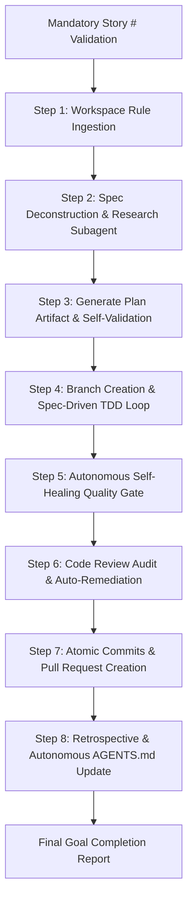

# Implement Story Skill (Autonomous Goal Edition)

This skill executes an **end-to-end, fully autonomous feature implementation goal** driven by formal AI specifications (Spec-Driven Development / SDD). Once started with a mandatory issue number, you MUST operate autonomously until all code development is complete, unit and integration tests pass 100% green, static analysis passes, senior code review audits pass, the Pull Request is submitted, and architectural learnings are persisted to `AGENTS.md`.

> [!IMPORTANT]
> **No Blocking Approval Gates:** Do not pause or wait for user confirmation between steps (such as plan approvals or learning approvals). Self-validate against the specification and drive the implementation to completion. For interactive pair programming with manual gates, direct the user to use `implement-github-story-interactive`.

---

## Execution Workflow



---

### Step 0: Mandatory Story Number Validation
- **Requirement:** A GitHub issue number is **MANDATORY**.
- Extract the issue ID from the user invocation (e.g., `/implement-github-story #42`, `implement-github-story 42`, or `implement issue 42`).
- **Strict Guardrail:** If no issue number was provided, **ABORT IMMEDIATELY** and respond with:
  > `Error: A GitHub issue number is mandatory for autonomous implementation.`  
  > `Usage: /implement-github-story #<issue-id>`  
  > `Tip: If you want to browse open issues interactively and approve each phase, use /implement-github-story-interactive.`
- Do NOT list open issues or pause to ask what to do.

---

### Step 1: Workspace Rule Ingestion & Environment Verification
- **Pre-flight Rule Ingestion:** Before modifying any files, read the workspace root `AGENTS.md` and any submodule guidelines (e.g. `backend/.agents/AGENTS.md`, `frontend/.agents/AGENTS.md`, `database/.agents/AGENTS.md`). Strictly internalize and obey all project rules:
  - Required build, test, and lint commands.
  - Architectural layering and directory conventions.
  - Hard prohibitions (e.g., never applying database migrations manually, never committing secrets or `.env` files).
- Verify the GitHub CLI (`gh`) and Git are authenticated and healthy:
  ```bash
  gh auth status
  git status
  ```

---

### Step 2: Spec Deconstruction & Research Subagent Delegation
- Fetch the complete issue specification:
  ```bash
  gh issue view <issue-id>
  ```
- **Deconstruct the AI Specification:**
  - In-scope **Goals** vs. explicit **Non-Goals (Out of Scope)** to prevent scope creep.
  - **Acceptance Criteria:** Construct an internal **Traceability Matrix** mapping every single Given/When/Then criterion directly to an anticipated test scenario.
  - Contract definitions: schemas, endpoints, types, and error conditions.
- **Delegate Codebase Exploration to a Subagent:**
  - Launch a `research` subagent to explore the codebase without cluttering the parent context.
  - The subagent identifies:
    - Target files to create or modify across modules.
    - Existing architectural patterns, shared services, and components to reuse.
    - Test harness patterns, fixtures, mock factories, and existing test utilities.
    - Submodule constraints from local `.agents/AGENTS.md` files.

---

### Step 3: Plan Generation & Autonomous Self-Validation
- Write a detailed **Implementation Plan** artifact to the conversation artifact directory (`write_file` with `ArtifactMetadata`):
  - **Spec Traceability Matrix:**
    | Acceptance Criterion | Target Implementation | Test File & Scenario |
    | :--- | :--- | :--- |
    | [Given X, When Y, Then Z] | [Target logic / handler] | [Unit/Integration Test] |
  - **Phased Technical Roadmap:**
    1. Test harness & contract mocks.
    2. Data models & schemas (obeying migration restrictions).
    3. Core business logic & API services.
    4. Frontend UI state machine (idle, loading, empty, success, error) if applicable.
    5. Quality gates & code review.
  - **File Breakdown:** Explicit list of files to create, edit, or delete.
- **Autonomous Validation:** Perform an automated sanity check against the issue's Acceptance Criteria and `AGENTS.md` constraints.
- **Proceed Immediately:** Do NOT wait for human approval. Proceed directly to Step 4.

---

### Step 4: Branch Creation & Spec-Driven TDD Loop
- **Branch Creation:** Ensure a clean base and create the feature branch:
  ```bash
  git checkout main
  git pull
  git checkout -b feature/issue-<id>-<short-description>
  ```
- **Test-Driven Red-Green-Refactor Loop:**
  1. **Red:** Write failing unit/integration tests directly derived from the Traceability Matrix (happy path, edge cases, error conditions).
  2. **Green:** Implement the minimal, clean code required to satisfy the tests.
  3. **Refactor:** Clean up code, remove duplication, and ensure adherence to architectural layers.

---

### Step 5: Autonomous Self-Healing Quality Gate
- **Static Analysis & Formatting:**
  - Run the project's formatter and linter (e.g. `npm run lint`, `make lint`, `cargo clippy`).
  - Automatically fix all lint and formatting errors.
- **Full Test Suite Execution:**
  - Run the project's test suite (e.g. `npm test`, `pytest`, `go test ./...`, `make test`).
- **Bounded Self-Healing Loop:**
  - If any test fails, do NOT stop to ask the user what to do.
  - Analyze the error trace, identify the defect, apply the fix, and re-run the tests.
  - Allow up to **3 automated self-healing iterations**. If still failing after 3 attempts, record the exact failure in the final summary.

---

### Step 6: Code Review Audit & Auto-Remediation
- Inspect all changes via `git diff origin/main...HEAD`.
- Verify:
  - No leftover debugging statements (`console.log`, `debugger`, `print`, `pdb`).
  - No secrets, tokens, credentials, or environment files staged.
  - No unintended changes or file renames.
- **Execute Senior Code Review:** Audit the changes against:
  - Architecture & Layering violations
  - Scalability bottlenecks & resource leaks
  - Security, auth gaps, and input validation
  - Test coverage completeness
- **Auto-Remediation:** If any **High** or **Critical** issues are found:
  - Immediately refactor and fix the offending code.
  - Re-run lints and tests to ensure zero regressions.

---

### Step 7: Atomic Commits & Pull Request Creation
- Stage and commit code using conventional commit standards:
  ```bash
  git commit -m "feat(<scope>): implement issue #<id> - <short description> (Closes #<id>)"
  ```
- Push the branch to remote:
  ```bash
  git push -u origin feature/issue-<id>-<short-description>
  ```
- Generate a structured Pull Request description:
  ```markdown
  ## Description
  Closes #<id>
  
  [Summary of changes and problem solved]

  ## Key Architectural Decisions
  - [Architectural choice / design pattern used]

  ## Verification & Acceptance Criteria Matrix
  - [x] Given [criterion 1] -> Covered in `[test_file]`
  - [x] Given [criterion 2] -> Covered in `[test_file]`

  ## Quality Checks
  - [x] Lint & formatting passed
  - [x] All unit & integration tests passed (100% green)
  - [x] Senior engineering code review passed
  ```
- Submit the Pull Request via GitHub CLI:
  ```bash
  gh pr create --title "<Issue Title>" --body-file /tmp/pr_body.md
  ```

---

### Step 8: Retrospective & Autonomous Learnings Persistence
- Extract reusable engineering guidelines, architectural invariants, framework quirks, test fixture conventions, or database rules discovered during implementation.
- **Autonomous AGENTS.md Update:**
  - Determine destination:
    - If changes were localized to a submodule (e.g., `backend/`), update `backend/.agents/AGENTS.md` (or `backend/AGENTS.md`).
    - If changes were cross-cutting or no submodule file exists, update the root `AGENTS.md`.
  - Append the high-signal learnings cleanly, matching the tone and conventions of existing entries.
  - Maintain brevity to respect file size budgets.

---

### Step 9: Final Goal Summary
Present a concise, structured completion report to the user:
- **Status:** Completed autonomously.
- **Pull Request URL:** [Link to PR]
- **Branch:** `feature/issue-<id>-<short-description>`
- **Verification Evidence:** Test results, linter status, and code review audit confirmation.
- **Learnings Persisted:** Brief summary of rules added to `AGENTS.md`.
