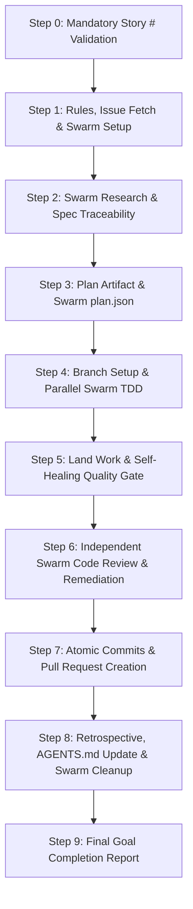

# Implement Story Skill (Autonomous Goal + Swarm Edition)

This skill executes an **end-to-end, fully autonomous feature implementation goal** driven by formal AI specifications (Spec-Driven Development / SDD) with a **Swarm running alongside** in the Swarm UI Overview pane.

> [!IMPORTANT]
> **Goal-Mode Persistence & Zero Blocking Gates:**
> - Designed to be triggered directly or via `/goal /implement-github-story #<issue-id>`.
> - Do **not** pause or wait for user approval between phases (plan approval, code review, or `AGENTS.md` updates).
> - Do **not** stop early: continue coordinating the swarm until every Acceptance Criterion is implemented, all test suites and linters pass 100% green, independent code review finds zero High/Critical defects, the Pull Request is created, verified learnings are persisted to `AGENTS.md`, and swarm workers are cleanly shut down.
> - For interactive pair programming with manual gates, direct the user to `/implement-github-story-interactive`.

---

## Execution Workflow



---

### Step 0: Mandatory Story Number Validation
- **Requirement:** A GitHub issue number is **MANDATORY**.
- Extract the issue ID from the user invocation (e.g., `/goal /implement-github-story #42`, `/implement-github-story #42`, `implement-github-story 42`, or `implement issue 42`).
- **Strict Guardrail:** If no issue number was provided, **ABORT IMMEDIATELY** and respond with:
  > `Error: A GitHub issue number is mandatory for autonomous implementation.`  
  > `Usage: /goal /implement-github-story #<issue-id>`  
  > `Tip: If you want to browse open issues interactively and approve each phase, use /implement-github-story-interactive.`
- Do NOT list open issues or pause to ask what to do.

---

### Step 1: Workspace Rule Ingestion, Issue Fetch & Swarm Initialization
1. **Pre-flight Rule Ingestion:**
   - Read the workspace root `.agents/AGENTS.md` (or `AGENTS.md`) and every relevant submodule rule file (`backend/.agents/AGENTS.md`, `frontend/.agents/AGENTS.md`, `database/.agents/AGENTS.md`).
   - Internalize all build/test/lint commands, architectural boundaries, constant conventions, and hard prohibitions (e.g., never applying DB migrations, never committing secrets or `.env` files).
2. **Environment & Issue Verification:**
   ```bash
   gh auth status
   git status
   gh issue view <issue-id>
   ```
3. **Initialize the Swarm & Overview Pane:**
   - Read the built-in `swarm_pane` skill (`SKILL.md`) before adding the first worker.
   - Set a clear swarm title:
     - `swarm(action="title", title="Issue #<id>: <short title>")`
   - You act as the **coordinator**: keep briefs self-contained (each worker starts fresh and sees only its brief and the board), name exact ownership and "done" criteria, and avoid spawning a narrator.

---

### Step 2: Spec Deconstruction & Swarm Research Delegation
- **Deconstruct the Specification:**
  - Separate in-scope **Goals** from explicit **Non-Goals**.
  - Extract every Given/When/Then **Acceptance Criterion**, API/schema contract, and error condition into a **Traceability Matrix**.
- **Spawn `researcher` Worker (`workspace: "inherit"`):**
  - Use `swarm(action="add", name="researcher", workspace="inherit", brief=...)`.
  - Brief the `researcher` to inspect target modules, reusable components/utilities, test harnesses/mocks, and submodule `AGENTS.md` constraints, and post a structured findings report on the board.
  - Immediately write `<appData>/brain/<conversation-id>/.system_generated/swarm/plan.json` (per `swarm_pane`) so the Swarm Overview renders live on the side.
  - Wait reactively for `researcher` to finish—never poll in a loop.

---

### Step 3: Implementation Plan Artifact & Swarm Topology
- Write the **Implementation Plan** artifact (`write_file` with `ArtifactMetadata`, `RequestFeedback: false`):
  - **Spec Traceability Matrix:**
    | Acceptance Criterion | Target Implementation | Test File & Scenario |
    | :--- | :--- | :--- |
    | [Given X, When Y, Then Z] | [Target logic / handler] | [Unit/Integration Test] |
  - **Phased Technical Roadmap & File Breakdown:** Explicit list of files to create, modify, or delete per module (obeying all migration & layering constraints).
- **Autonomous Validation:** Self-validate the plan against every Acceptance Criterion and `AGENTS.md` rule. Do NOT pause for human approval.
- **Create Feature Branch First (in Coordinator Workspace):**
  ```bash
  git checkout main
  git pull
  git checkout -b feature/issue-<id>-<short-description>
  ```

---

### Step 4: Parallel Swarm TDD Implementation
Choose the leanest swarm roster that matches the story's scope:
- **Multi-module story** (e.g., `backend/` + `frontend/`, or independent packages):
  - Spawn parallel authors with **`workspace: "share"`** (e.g., `backend-dev`, `frontend-dev`) so each edits and runs tests in its own isolated working copy without conflicting.
  - Keep database DDL files (if any, never executed) owned by a single designated worker to preserve the single-migration-pair rule.
- **Single-module story** (tightly coupled edits in one area):
  - Spawn a single `implementer` worker (`workspace: "inherit"`).

**Every author's brief MUST mandate:**
1. Exact files/module owned and Acceptance Criteria rows from the Traceability Matrix.
2. **TDD Red-Green-Refactor:** write failing tests first, implement minimal clean code to pass, then refactor.
3. Strict adherence to `AGENTS.md` conventions (including `static final UPPER_SNAKE_CASE` constants, descriptive names, 100% coverage targets, and zero suppressed static-analysis warnings).
4. Run module-scoped tests & linters before posting completion on the board.
5. For visible UI changes, capture and flag full-window screenshots on the board post using `Screenshot: <absolute path> | <summary>` (per `swarm_pane`).

Update `plan.json` whenever workers are added or work moves. Wait reactively for workers to report completion.

---

### Step 5: Land Worker Changes & Autonomous Self-Healing Quality Gate
1. **Land Isolated Workspaces:**
   - For any worker using `workspace: "share"`, commit or merge/cherry-pick its verified changes cleanly into the coordinator's `feature/issue-<id>-<short-description>` branch before running full-repo gates.
2. **Spawn `verifier` Worker (`workspace: "inherit"`)** (or run directly if trivial):
   - Execute full workspace formatting, linting, static analysis, coverage verification, and test suites (e.g., `make lint`, `make test`, `./gradlew test jacocoTestReport checkstyleMain checkstyleTest spotbugsMain spotbugsTest`).
3. **Bounded Self-Healing Loop (Up to 3 Iterations):**
   - If any test, coverage check, or static analysis gate fails, do NOT stop or ask the user.
   - Post the exact failing test/diagnostic trace to the owning worker (`@backend-dev` / `@frontend-dev` / `@implementer`) to fix, re-land, and re-verify.
   - If still failing after 3 automated cycles, record the exact failure trace and root cause in the final Goal Completion Report.

---

### Step 6: Independent Swarm Code Review & Auto-Remediation
- Spawn a fresh **`reviewer`** worker (`workspace: "inherit"`) to audit `git diff origin/main...HEAD` independently against:
  - Architecture, layering boundaries, and dead/test-only code.
  - Security, auth, input validation, and secret hygiene (zero `.env`/keys/debug prints).
  - Concurrency, scalability, and resource safety.
  - Spec traceability completeness and edge-case test coverage.
- **Auto-Remediation:** If `reviewer` flags any **High** or **Critical** findings:
  - Address them immediately (via the owning worker or coordinator), re-run the full quality gate (Step 5), and have `reviewer` sign off.

---

### Step 7: Atomic Commits & Pull Request Creation
- Verify `git status` and `git diff origin/main...HEAD` are completely clean of unintended edits.
- Stage and commit using conventional / imperative commit format matching repo `AGENTS.md`:
  ```bash
  git commit -m "feat(<scope>): implement issue #<id> - <short description> (Closes #<id>)"
  ```
- Push branch to remote:
  ```bash
  git push -u origin feature/issue-<id>-<short-description>
  ```
- Create a structured Pull Request via GitHub CLI:
  ```markdown
  ## Description
  Closes #<id>

  [Summary of changes and problem solved]

  ## Key Architectural Decisions
  - [Architectural choice / design pattern used]

  ## Verification & Acceptance Criteria Matrix
  - [x] Given [criterion 1] -> Covered in `[test_file]`
  - [x] Given [criterion 2] -> Covered in `[test_file]`

  ## Quality Checks
  - [x] Lint, static analysis & formatting passed
  - [x] All unit & integration tests passed (100% green)
  - [x] Independent swarm senior code review passed
  ```
  ```bash
  gh pr create --title "<Issue Title>" --body-file /tmp/pr_body.md
  ```

---

### Step 8: Retrospective, Autonomous `AGENTS.md` Update & Swarm Cleanup
1. **Persist Verified Learnings:**
   - Extract high-signal, reusable engineering guidelines, framework quirks, or architectural invariants discovered during the goal.
   - Update the most specific `AGENTS.md` (`backend/.agents/AGENTS.md`, `frontend/.agents/AGENTS.md`, `database/.agents/AGENTS.md`, or root `.agents/AGENTS.md`) and commit/push the doc update to the PR branch.
2. **Clean Swarm Teardown:**
   - Only **after** every worker's work is landed, pushed, and verified, terminate all swarm workers with `swarm(action="kill", name=...)`.

---

### Step 9: Final Goal Completion Report
Present a concise, structured completion report to the user:
- **Status:** Completed autonomously (Goal + Swarm).
- **Pull Request URL:** [Link to PR]
- **Branch:** `feature/issue-<id>-<short-description>`
- **Swarm Summary:** Workers used (`researcher`, authors, `verifier`, `reviewer`) and outcome.
- **Verification Evidence:** Test counts, coverage, linter/static analysis status, and review sign-off.
- **Learnings Persisted:** Brief summary of rules added to `AGENTS.md`.
