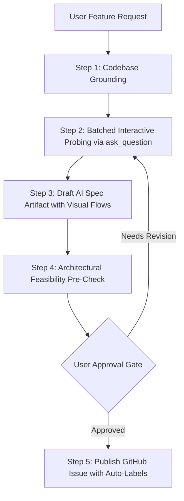
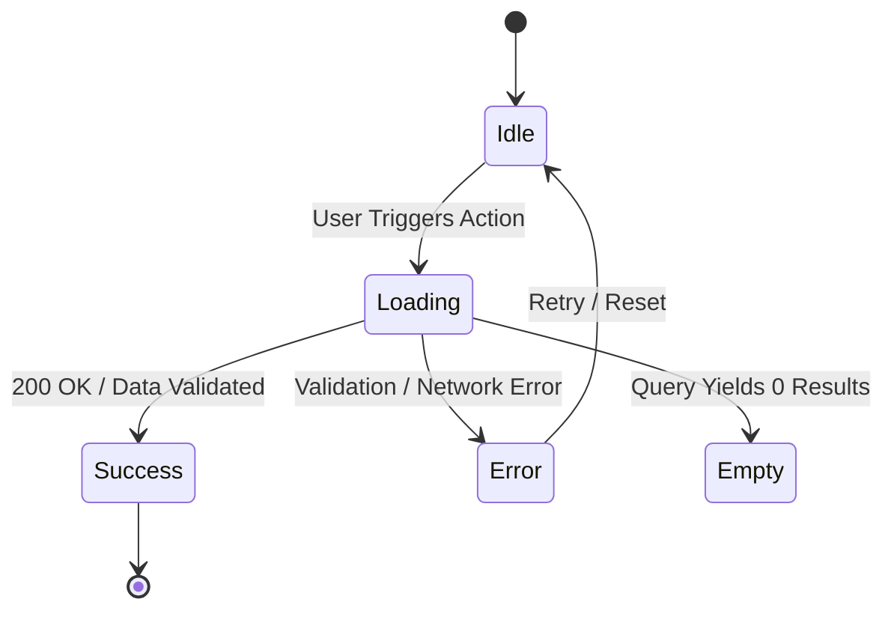

# Write Story Skill (AI Specification Authoring)

This skill guides the agent in conducting a structured, contract-driven requirement gathering process (Spec-Driven Development / SDD), grounding specifications in existing codebase architecture, and automatically generating and publishing an AI-ready GitHub issue.

The goal is to produce specifications that downstream engineering agents or developers can implement deterministically without ambiguities, hallucinations, or scope creep.

---

## Execution Workflow



---

### 1. Codebase Grounding & Architecture Context
Before asking blind questions, inspect the repository to ground the feature in reality:
- Check root and submodule architecture guidelines (`AGENTS.md`, `backend/.agents/AGENTS.md`, etc.).
- Identify existing data models, API endpoints, state management conventions, and UI component libraries that should be extended or reused.
- Use your findings to formulate informed, high-context technical options rather than asking generic questions.

---

### 2. Batched Interactive Probing (The Interview Phase)
Do not overwhelm the user with 15 single-turn questions. Group the interview into **2-3 logical batches** and use the `ask_question` tool with structured options and recommended defaults:

#### Batch 1: Scope, Boundaries & User Experience
- **Goals & Explicit Non-Goals:** Pin down what is in-scope vs. what is explicitly deferred to prevent scope creep.
- **User Journey & Personas:** Who is the actor? What is the happy path and primary edge cases?
- **UI States & Component Hierarchy:** Determine required states (*idle*, *loading*, *empty*, *active*, *success*, *error*).

#### Batch 2: Technical Contracts, Data & Security
- **API Contracts:** Request/response payloads, endpoints, HTTP verbs, status codes, and validation rules.
- **Database Schema & Migrations:** New columns, relationships, indexes, and repo migration constraints.
- **Security & Authorization:** Required roles, auth guards, input sanitization, and OWASP defenses.
- **Non-Functional Requirements (NFRs):** Latency budgets, pagination, rate limits, and observability logging.

---

### 3. Draft the AI Specification Artifact
Compile the aligned requirements into an interactive markdown artifact in the conversation artifact directory (`write_file` with `ArtifactMetadata` and `RequestFeedback: true`).

The specification **MUST** follow this structured template:

```markdown
# [Feature] <Feature Name>

## 1. Overview & Context
- **Problem Statement:** [What user problem or business friction does this solve?]
- **User Story:** As a [user role], I want to [action] so that [business value / outcome].
- **Target Persona:** [Primary user or system component]

## 2. Goals & Non-Goals
### Goals
- [Measurable in-scope objective 1]
- [Measurable in-scope objective 2]

### Non-Goals (Out of Scope)
- [Explicit boundary / what will NOT be built in this story]
- [Deferred future enhancement]

## 3. Visual State Machine & User Journey


## 4. Technical Specification
### Frontend & UI Architecture
- **Target Components:** [File paths, components to create/modify]
- **State Management:** [Store changes, local hooks, query caching]
- **UI States Handled:** Idle, Loading, Empty, Success, Inline Error

### Backend & API Contracts
- **Endpoints:**
  - `[METHOD] /api/v1/[endpoint]`
    - **Headers:** `Authorization: Bearer <token>`, `Content-Type: application/json`
    - **Request Payload:**
      ```json
      {
        "field_name": "type (required | optional - constraint)"
      }
      ```
    - **Response (200 OK / 201 Created):**
      ```json
      {
        "id": "uuid",
        "status": "success"
      }
      ```
    - **Error Responses:** `400 Bad Request`, `401 Unauthorized`, `403 Forbidden`, `404 Not Found`, `422 Unprocessable`
- **Validation Rules:** [Field constraints, regex patterns, size limits]

### Database & Migrations
- **Schema Changes:** [Tables, columns, types, foreign keys, indexes]
- **Migration Strategy:** [Reversibility, zero-downtime safety, obeying repo AGENTS.md rules]

### Security & Non-Functional Requirements
- **Auth & Access Control:** [Required roles / scopes / ACLs]
- **Performance & Caching:** [Query indexing, cache-control, pagination limits]
- **Observability:** [Structured log events, error reporting tags]

## 5. Verifiable Acceptance Criteria (Given / When / Then)
### Positive Scenarios (Happy Path)
- [ ] **Given** [pre-condition], **When** [action taken], **Then** [expected testable outcome].

### Edge Cases & Negative Scenarios
- [ ] **Given** [invalid input / missing data], **When** [action submitted], **Then** [validation error returned].
- [ ] **Given** [unauthorized user], **When** [resource accessed], **Then** [401/403 returned].
- [ ] **Given** [downstream timeout], **When** [action taken], **Then** [graceful degradation].

## 6. Definition of Done (DoD)
- [ ] Unit & integration tests pass with 100% green status.
- [ ] Static analysis and linter pass with zero warnings.
- [ ] Senior code review completed with 0 High/Critical findings.
- [ ] Pull Request opened and linked.
```

---

### 4. Architectural Feasibility Pre-Check
Before asking the user to approve:
- Verify that referenced files, modules, and import paths exist or match the project layout.
- Check that proposed database schema changes do not violate existing migrations or conventions.
- Flag any technical trade-offs directly in the summary.

---

### 5. Review, Approval & GitHub Issue Creation
- Present the spec artifact to the user and request approval.
- Once approved, determine appropriate GitHub labels (e.g. `type:feature`, `area:backend`, `area:frontend`, `status:ready`).
- Save the spec to a temporary file (`/tmp/issue_spec.md`) and create the issue:
  ```bash
  gh issue create --title "[Feature] <Short Description>" --body-file /tmp/issue_spec.md --label "type:feature"
  ```
- Output the generated Issue Number and GitHub URL.
