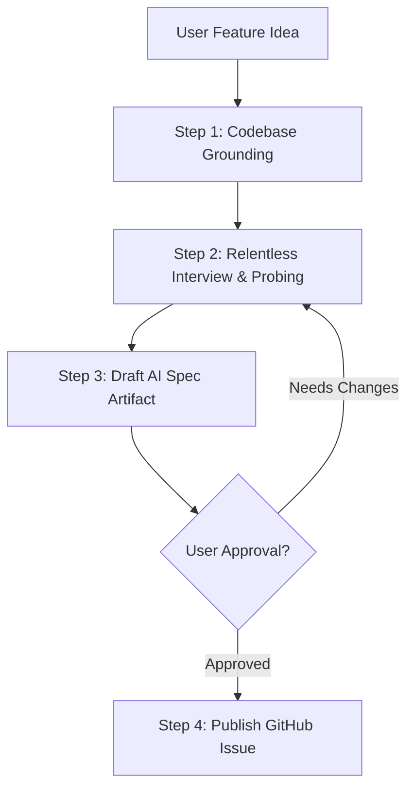

# Write Story Skill

This skill guides the agent in conducting a structured, contract-driven requirement gathering process (Spec-Driven Development / SDD), grounding requirements in the codebase architecture, and automatically generating and publishing a comprehensive, AI-ready specification as a GitHub issue.

The goal is to produce specifications that downstream engineering agents or developers can implement deterministically without ambiguities, hallucinations, or scope creep.

---

## Execution Workflow



### 1. Codebase Grounding & Architecture Context
Before asking blind questions, inspect the repository to ground the feature in reality:
- Check root and submodule architecture (e.g. `backend/`, `frontend/`, `database/`, and their `.agents/AGENTS.md` guidelines).
- Identify existing models, API endpoints, state management conventions, and UI component libraries that can be reused.
- Use your findings to ask informed, high-context technical questions rather than generic ones.

### 2. Relentless Requirement Gathering (The Interview Phase)
- Ask questions **one at a time** to walk down the decision tree and resolve ambiguities.
- Whenever trade-offs or technical choices arise, use the `ask_question` tool to provide structured options with clear recommendations.
- **Define Boundaries Early:** Explicitly establish **Goals** and **Non-Goals (Out of Scope)** to prevent downstream scope creep.
- Proactively probe across all architectural layers:
  - **User Journeys & Personas:** Who is the actor? What is the primary happy path? What are the edge cases or failure modes?
  - **Frontend UI/UX & State Machine:** Views, components, responsive layout, accessibility, and explicit states: *idle*, *loading*, *empty*, *active*, *success*, and *error*.
  - **Backend / APIs & Contract Definition:** Endpoints, HTTP methods, headers, request/response payload schemas (field types, nullability), validation constraints, and error status codes.
  - **Database Schema & Migrations:** New tables, columns, indexes, foreign key relationships, data backfill/seeding requirements, and migration reversibility. *(Always respect repo-specific migration rules!)*
  - **Security, Auth & Permissions:** Authentication mechanisms, RBAC/authorization rules, CSRF/CORS, input sanitization, sensitive data handling, and OWASP defenses.
  - **Non-Functional Requirements (NFRs):** Performance/latency expectations, pagination, rate-limiting, caching strategy, timeouts, and resilience.
  - **Observability:** Structured logging, metrics, audit trails, and error tracking.

### 3. Draft the AI Specification Artifact
Once requirements are aligned, compile the specification into an interactive markdown artifact in the artifact directory (`write_to_file` with `ArtifactMetadata` and `RequestFeedback: true`).

The specification **MUST** follow this comprehensive template:

```markdown
# [Feature] <Feature Name>

## 1. Overview & Context
- **Problem Statement:** [What user problem or business friction does this solve?]
- **User Story:** As a [user role], I want to [action] so that [business value / outcome].
- **Target Persona:** [Primary user or system component]

## 2. Goals & Non-Goals
### Goals
- [Concrete, measurable in-scope objective 1]
- [Concrete, measurable in-scope objective 2]

### Non-Goals (Out of Scope)
- [Explicit boundary / what will NOT be built in this story]
- [Deferred future enhancement]

## 3. User Journey & UI State Machine
- **Primary Flow:** [Step-by-step user interaction sequence]
- **UI States:**
  - *Idle / Default:* [Description]
  - *Loading / Submitting:* [Visual indicator / disabled states]
  - *Empty State:* [Visual representation when no data exists]
  - *Success State:* [Visual confirmation / redirect]
  - *Error State:* [Inline validation / toast / banner error details]

## 4. Technical Specification
### Frontend
- **Components:** [New or modified components, props, file paths]
- **State Management:** [Local state, global store, or server-cache changes]
- **Styling & Responsiveness:** [Tailwind / CSS rules, mobile/desktop breakpoints]

### Backend & API Contracts
- **Endpoints:**
  - `[METHOD] /api/v1/[endpoint]`
    - **Headers:** `Authorization: Bearer <token>`, `Content-Type: application/json`
    - **Request Payload:**
      ```json
      {
        "field_name": "type (required | optional - constraint)"
      }
      ```
    - **Response (200 OK / 201 Created):**
      ```json
      {
        "id": "uuid",
        "status": "success"
      }
      ```
    - **Error Responses:** `400 Bad Request`, `401 Unauthorized`, `403 Forbidden`, `404 Not Found`, `422 Unprocessable`
- **Business Logic & Validation:** [Key algorithms, validation rules, rate limiting]

### Database & Migrations
- **Schema Changes:** [Tables, columns, types, nullability, constraints, indexes]
- **Data Migrations / Backfills:** [Required one-time scripts or seeding]
- **Migration Strategy:** [Reversibility / rollback safety]

### Security & Compliance
- **Authentication & Authorization:** [Required roles / scopes / RBAC]
- **Data Protection:** [Sanitization, encryption, PII handling]

### Non-Functional Requirements (NFRs)
- **Performance & Caching:** [Query performance, caching layer, pagination limits]
- **Resilience:** [Timeouts, retry policies, fallback behavior]
- **Observability:** [Structured log events, key metrics, alert triggers]

## 5. Verifiable Acceptance Criteria
### Positive Scenarios (Happy Path)
- [ ] **Given** [pre-condition], **When** [action taken], **Then** [expected testable outcome].

### Negative & Edge Cases
- [ ] **Given** [invalid input / missing data], **When** [action submitted], **Then** [validation error returned].
- [ ] **Given** [unauthenticated / unauthorized user], **When** [resource accessed], **Then** [401/403 returned].
- [ ] **Given** [network failure / backend timeout], **When** [action taken], **Then** [graceful degradation].

## 6. Definition of Done (DoD)
- [ ] Unit tests written and passing with expected coverage.
- [ ] Integration / API contract tests passing.
- [ ] Linter and static analysis checks passing without warnings.
- [ ] Code reviewed against architectural, security, and scalability standards.
- [ ] No regression in existing test suites.
```

### 4. Review & Approval Gate
- Present the generated artifact to the user.
- Highlight key decisions, trade-offs, or open questions.
- Await user approval. If the user suggests modifications, update the artifact and confirm before proceeding.

### 5. GitHub Issue Creation
- Once the user explicitly approves the specification, save the spec to a temporary file (e.g. `/tmp/issue_spec.md`).
- Create the issue using the GitHub CLI (`gh`):
  ```bash
  gh issue create --title "[Feature] <Short Description>" --body-file /tmp/issue_spec.md
  ```
- Print the created issue URL and issue number.
- **Graceful Fallbacks:** If `gh` is unauthenticated or encounters environment restrictions, provide the full markdown text for manual creation and inform the user.
